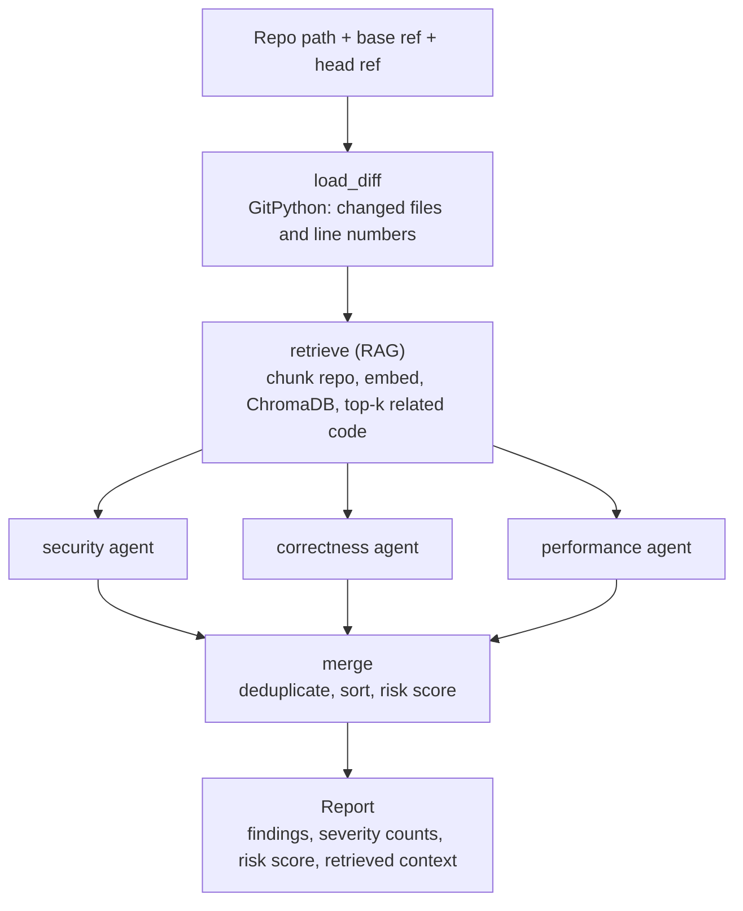

# Argus

Argus reviews a pull request with three LLM agents (security, correctness, performance) that run in parallel. Before they review, it retrieves related code from the rest of the repository (RAG), so an agent can check a change against code the PR did not touch. The agents' findings are merged into one report with a risk score.

Built with Python, LangGraph, LangChain, ChromaDB, Gemini, GitPython, Pydantic and FastAPI.

## How it works



1. **load_diff** reads the diff between two refs and numbers each changed line so the agents can cite line numbers.
2. **retrieve** (skipped with `--no-rag`) splits the repository at the head commit into chunks, embeds them with Gemini, stores them in ChromaDB, and searches with a query built from the changed code and its identifiers. The top 4 chunks (configurable) become context. Chunks that overlap the diff are excluded, since the agents already see those.
3. **security / correctness / performance** run in parallel as a LangGraph fan-out. Each makes one Gemini call and returns validated structured findings (file, line, category, severity, description, suggested fix).
4. **merge** waits for all three (fan-in), removes duplicate findings, sorts them, and computes the risk score. It is plain Python and uses no LLM.

Only three agents are used on purpose. See [INTERVIEW_GUIDE.md](INTERVIEW_GUIDE.md) for why, and for a plain-language explanation of every part.

### Risk score

Each merged finding adds points by severity: critical 40, high 20, medium 8, low 2. The total is capped at 100. The risk level is the worst severity present. Because the score is computed after duplicates are merged, the same problem reported by two agents counts once.

## Quick start

You need Python 3.12+ and [uv](https://docs.astral.sh/uv/) (`python -m pip install uv` if you do not have it; if the `uv` command is then not found, write `python -m uv` instead of `uv` below).

**1. Install**

```bash
git clone https://github.com/sathvik1610/argus.git
cd argus
uv sync --dev
```

**2. Check that everything works (no API key needed)**

```bash
uv run pytest
```

Expected: `76 passed, 2 skipped`. The 2 skipped tests call the real Gemini API and only run once you add a key.

**3. Add your Gemini key (needed to review anything)**

Create `.env` from the template, then edit it and replace `your-gemini-api-key-here` with your key from https://aistudio.google.com/apikey.

```bash
cp .env.example .env
```

(`cp` works in Git Bash and PowerShell. In cmd.exe use `copy .env.example .env`.)

Optional: `ARGUS_LLM_MODEL` and `ARGUS_EMBEDDING_MODEL` in `.env` change the models. Defaults: `gemini-2.5-flash` and `models/gemini-embedding-001`.

**4. Review a repository**

```bash
uv run python -m argus /path/to/repo --base main --head my-branch
```

`--base` is the "before" branch or commit, `--head` the "after" (default `HEAD`). Windows paths work as written, for example `D:\GitHub\myproject`.

```bash
uv run python -m argus /path/to/repo --base main --head my-branch --no-rag
uv run python -m argus /path/to/repo --base HEAD~1 --json
```

`--no-rag` reviews the diff only (no retrieval, no embedding calls). `--json` prints the full report as JSON.

## Running the API

The API only reads repositories inside folders you list in `ARGUS_ALLOWED_REPO_DIRS`. If it is empty, every request is refused with 403.

Set it for the current terminal:

```bash
# Git Bash / Linux / macOS
export ARGUS_ALLOWED_REPO_DIRS=/home/me/projects
```

```powershell
# Windows PowerShell
$env:ARGUS_ALLOWED_REPO_DIRS = "D:\GitHub"
```

Or put `ARGUS_ALLOWED_REPO_DIRS=D:\GitHub` in your `.env` file. Several folders are separated by `;` on Windows and `:` elsewhere.

Start the server, then open http://localhost:8000/docs for an interactive page where you can try the endpoints:

```bash
uv run uvicorn argus.api:app
```

```bash
curl http://localhost:8000/health
curl -X POST http://localhost:8000/review -H "Content-Type: application/json" -d '{"repo_path": "/home/me/projects/app", "base": "main", "head": "feature", "rag": true}'
```

`POST /review` returns the summary, findings, severity counts, risk score, the files with findings, and the retrieved context (file and line range of each snippet). Argus never executes code from the reviewed repository; it only reads files through git.

## Troubleshooting

| Message | Meaning and fix |
|---|---|
| `GOOGLE_API_KEY is not set` | `.env` is missing, is not in the folder you run from, or still has the placeholder. Fix step 3. |
| `not a git repository` | The path is not a git repo. Point at the folder that contains `.git`. |
| `unknown ref: ...` | A branch or commit name does not exist in that repo. Check with `git branch -a`. |
| API returns 403 | The repo is outside `ARGUS_ALLOWED_REPO_DIRS`, or that variable is empty. |
| API returns 503 | The API key is not configured (same as the first row). |
| 404 or "model not found" from Google | The default model name is not available to your key. Set `ARGUS_LLM_MODEL` or `ARGUS_EMBEDDING_MODEL` in `.env` to a model your key supports. |
| 429 or "quota" errors | Free-tier rate limit. Wait a minute, or run the evaluation with `--pause 10`. |
| `uv: command not found` | Run `python -m pip install uv`, then use `python -m uv ...`. |

## Evaluation: does RAG help?

`evaluation/` holds 14 small PR scenarios: 4 security bugs, 4 correctness bugs, 3 performance bugs, and 3 clean changes. Four of the bugs can only be spotted with code outside the changed file (for example, a function that returns cents being compared against `50` dollars).

```bash
uv run python -m evaluation.run --pause 5     # needs a real GOOGLE_API_KEY
```

It reviews each scenario twice (diff only, then diff plus RAG) and saves to `evaluation/results/`:
- the raw findings from every run,
- which planted bugs were caught, and false positives,
- token usage and latency.

The scenarios were written by the project author and each is run once, so treat results as a smoke test, not a benchmark.

## Testing

```bash
uv run pytest                  # 76 tests need no API key (2 more run only with one)
uv run ruff check . && uv run ruff format --check .
uv run mypy src evaluation
```

## Project status: what is verified and what is not

| Area | Status |
|---|---|
| Git diff parsing, chunking, file filtering, retrieval, merge, risk score, LangGraph wiring (including real parallel execution), API, evaluation scoring and runner | **Tested** with a fake LLM and fake embeddings. Retrieval was tested with a deterministic word-hash embedding, not a real model. |
| Binding Gemini classes to our output schema | **Checked offline** (no API call). |
| Real Gemini chat and embedding calls | **Not yet run.** `tests/test_real_gemini.py` covers this and is skipped until a real `GOOGLE_API_KEY` is set. |
| Review quality, and whether RAG improves it | **Not measured yet.** `evaluation/results/` is empty until the evaluation is run with a real key. |

Mocked tests prove the code is wired correctly. They say nothing about how good the reviews are.

## Limitations

- Review quality depends on the model, and has not been measured yet.
- Chunking is simple: Python is split at function boundaries (with the standard `ast` module); other languages use overlapping 50-line windows.
- Retrieval is pure vector similarity. There is no keyword search or re-ranking, and no second retrieval round if an agent wants more context.
- Embedding a large repository takes many API calls (capped at 1500 chunks by default). Embeddings are cached per commit.
- The diff sent to the model is truncated at 12,000 characters.
- Matching findings against the planted bugs in the evaluation is approximate (file plus line or keyword).

## Layout

```
src/argus/
  config.py     settings and the API key
  git_diff.py   diff extraction with line numbers
  chunking.py   file filters and code chunking
  index.py      ChromaDB index (one collection per commit)
  retrieval.py  builds queries, picks top-k related code
  models.py     Pydantic models (Finding, Report, ...)
  agents.py     the three reviewer prompts and one shared reviewer function
  graph.py      the LangGraph workflow
  merge.py      deduplication and risk score
  service.py    review_repo(): what the CLI, API and evaluation call
  api.py        FastAPI app
evaluation/     scenarios, scoring, and the with/without RAG runner
tests/          unit and integration tests (fake LLM)
temp/           earlier modules, kept for reference
```
