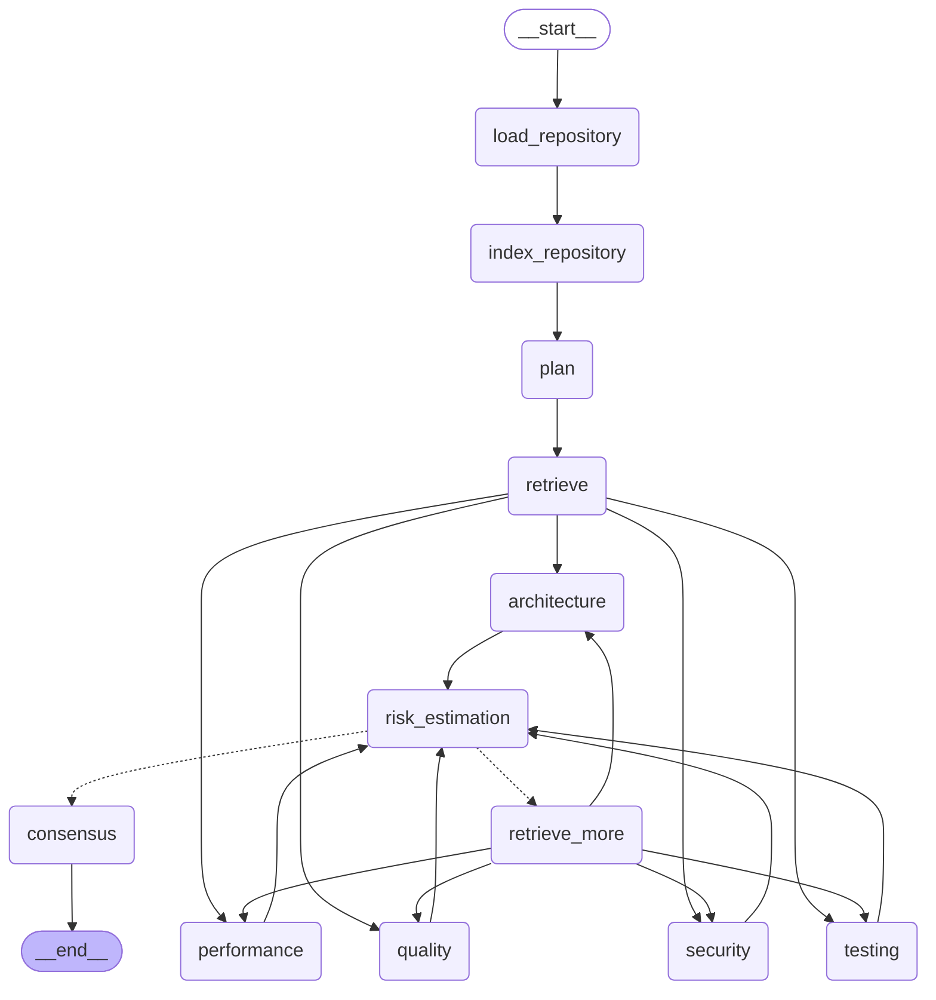

# Argus

**Argus** is a multi-agent AI platform that reviews pull requests the way a
senior engineer would — not by pasting a diff into one big prompt, but by
planning the review, retrieving only the code that's actually relevant, and
running five independent specialist reviewers (security, performance,
architecture, code quality, testing) before synthesizing everything into one
report.

Built on [LangGraph](https://github.com/langchain-ai/langgraph) for
orchestration and [LangChain](https://github.com/langchain-ai/langchain) for
LLM/embedding integration.

> New here? [`docs/HowItWorks.md`](docs/HowItWorks.md) explains what this does
> in plain English, no technical background needed.
>
> See [`docs/Architecture.md`](docs/Architecture.md) for the full design
> rationale — why the graph is shaped the way it is, why LangGraph vs. a
> plain chain, and the retrieval strategy that keeps this practical on repos
> well beyond toy size.

## Overview

Given a local git repository and two refs (a base and a head — i.e. a pull
request), Argus produces:

- A **risk assessment** with an overall severity and numeric score
- A **security review** (vulnerabilities, CWE ids, concrete fixes)
- A **performance review** (bottlenecks, complexity estimates, memory concerns)
- An **architecture review** (coupling, cohesion, SOLID violations, layering)
- A **code quality review** (naming, duplication, complexity, maintainability score)
- A **testing review** (missing tests, integration risks, edge cases)
- A **final recommendation** (`approve` / `approve_with_comments` /
  `request_changes` / `block`) with a confidence score and a list of files
  that need manual review regardless of what the automated review concluded

## Architecture



The five reviewers run **in parallel** (LangGraph fan-out/fan-in) rather than
as a sequential chain, since they don't depend on each other's output. If the
risk-estimation agent decides it's missing something specific, the graph
loops back through `retrieve_more` and re-runs the reviewers with expanded
context — capped at a configurable number of rounds. Full rationale in
[`docs/Architecture.md`](docs/Architecture.md).

## Installation

Requires Python 3.12+ and [`uv`](https://docs.astral.sh/uv/).

```bash
git clone https://github.com/sathvik1610/argus.git
cd argus
uv sync --dev
cp .env.example .env
```

Edit `.env` and set an API key for at least one provider (`GOOGLE_API_KEY`,
`OPENAI_API_KEY`, `ANTHROPIC_API_KEY`) — or point `ARGUS_LLM_PROVIDER=ollama`
at a local Ollama instance for a fully offline setup. Default provider is
Google Gemini (`gemini-2.0-flash`).

Verify your setup:

```bash
uv run argus doctor
```

## Quick start

```bash
# Review the diff between main and a feature branch in a local repo
uv run argus review /path/to/some/repo --base main --head feature/my-branch

# Or against a specific commit range
uv run argus review /path/to/some/repo --base HEAD~5 --head HEAD
```

## CLI usage

```
argus review <repo_path> --base <ref> [--head <ref>] [--format console|markdown|json] [--output <file>]
argus index <repo_path> [--ref <ref>]      # build/refresh the semantic index without reviewing
argus graph [--output <file>]              # print the workflow's Mermaid diagram
argus config                               # show resolved configuration (secrets masked)
argus doctor                               # check environment/provider/git setup
```

Exit code is `1` when the final recommendation is `block`, so `argus review`
can gate a CI pipeline.

## API usage

```bash
uv run uvicorn argus.api.app:app --reload
```

```bash
curl -X POST http://localhost:8000/review \
  -H "Content-Type: application/json" \
  -d '{"repo_path": "/path/to/repo", "base_ref": "main", "head_ref": "HEAD"}'

curl http://localhost:8000/health
curl http://localhost:8000/graph     # Mermaid diagram as JSON
curl http://localhost:8000/metrics   # basic in-process counters
```

### Docker

```bash
docker build -t argus .
docker run -p 8000:8000 --env-file .env argus
```

## Graph visualization

```bash
uv run argus graph
```

prints the Mermaid source for the diagram above, generated directly from the
compiled LangGraph graph — it can't drift from the actual code.

## Example output

Running `argus review` produces a report like this (`--format markdown`):

```markdown
# Argus Review Report

**Recommendation:** `block`
**Confidence:** 85%
**Overall risk:** 🟠 high (72/100)

## Summary

This PR introduces a SQL injection vulnerability that must be fixed before merge.

## Risk assessment

A SQL injection vector was introduced in the new query builder.

**Files requiring manual review:**
- `app/db/query.py`

## Security

One high-severity injection vulnerability found.

- 🟠 **SQL injection via unescaped user input** (`app/db/query.py`:42) — CWE-89
  - User-controlled `name` is interpolated directly into the query.
  - Fix: Use a parameterized query instead of string formatting.

## Performance

- **Nested loop over request items** (O(n^2)) — `app/db/query.py`
  - O(n^2) scan on every request.

## Suggested improvements

- Parameterize the query in app/db/query.py
```

## Screenshots

_Placeholder — CLI console output and API responses to be added here._

## Roadmap / future work

- Streaming responses from `/review`
- GitHub webhook integration (post the report as a PR comment)
- Incremental indexing (re-embed only changed chunks, by content hash)
- Review result caching keyed on `(repo, base_ref, head_ref)`
- Human-approval node before consensus for high-risk reviews
- MCP-compatible tool exposure

## Limitations

- Import-graph-based file ranking currently resolves Python and JavaScript/TypeScript
  imports only; other tree-sitter-supported languages are still indexed and
  retrievable, just without import-graph ranking (see Architecture.md).
- `ReviewState` holds live in-process objects (the import graph, the vector
  index handle) rather than serialized state, so the graph runs in-process
  and does not currently checkpoint across a process boundary.
- Anthropic has no embeddings API; embeddings fall back to Google when the
  chat provider is Anthropic and no explicit embedding provider is set.

## Development

```bash
uv sync --dev
uv run pytest                 # test suite
uv run ruff check .           # lint
uv run ruff format .          # format
uv run mypy src                # type check
uv run pre-commit install     # optional: run the above on every commit
```
