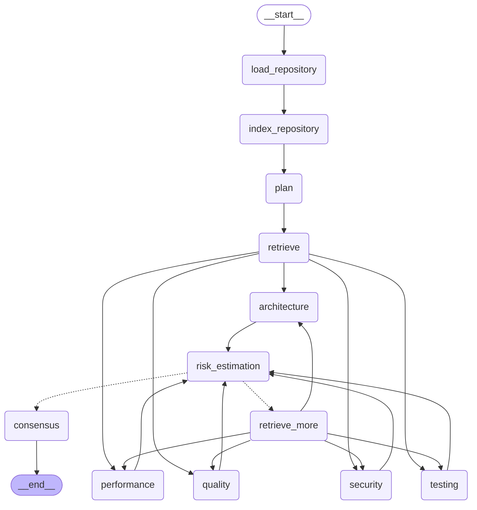

# Architecture

## System overview

Argus reviews a pull request (a diff between two git refs) the way a senior
engineer would: it doesn't paste the whole diff into one prompt and ask for
"a review". It plans, retrieves only the code that's relevant, runs five
independent specialist reviewers in parallel, estimates risk, optionally goes
back for more context, and synthesizes everything into one report.

```
                          ┌─────────────────────┐
   CLI (Typer)  ───────►  │                     │
   API (FastAPI) ───────► │   Review Graph       │ ───► FinalReview
                          │   (LangGraph)        │      (structured report)
                          └─────────┬───────────┘
                                    │
                    ┌───────────────┼────────────────┐
                    ▼               ▼                ▼
             Repository       Retrieval         Review Agents
             tools (git,      (AST chunking,    (LangChain +
             tree-sitter,     import graph,     structured output)
             import graph)    Chroma)
```

- **CLI** (`argus review|index|graph|config|doctor`) and **API**
  (`POST /review`, `GET /health|graph|metrics`) are two thin entrypoints over
  the same `services.review_service.run_review`.
- **LangGraph** owns orchestration: state, branching, and the
  context-expansion retry loop.
- **LangChain** owns LLM integration: provider-agnostic chat models,
  structured output parsing, and embeddings.
- **Retrieval** (tree-sitter + a hand-rolled import graph + Chroma) decides
  *what code the agents actually see* — the part of this project that matters
  most once a repo is bigger than a toy example.

## Why the graph looks like this — and why it's not the spec's version

The brief's original graph runs Security → Performance → Architecture →
Quality → Testing → Risk as one long sequential chain. That version does not
actually need LangGraph: it's a for-loop with extra ceremony. Nothing in the
brief says the reviewers depend on each other's output, and inspecting what
they produce confirms they don't — Security's job is not informed by
Performance's findings.

Argus instead fans the five reviewers out **in parallel** after retrieval,
and fans them back **in** at a single `risk_estimation` node:



Regenerate this diagram any time with `argus graph` (or `GET /graph`) —
it's rendered directly from the compiled graph, not hand-drawn, so it can
never drift from the actual code.

### Node-by-node

| Node | Responsibility |
|---|---|
| `load_repository` | Opens the repo with GitPython, computes a structured diff (`base_ref`..`head_ref`) |
| `index_repository` | Reads every source file at `head_ref`, AST-chunks it, builds the import graph, embeds chunks into Chroma |
| `plan` | Planner agent: decides review depth (quick/standard/deep) and focus areas from the diff alone |
| `retrieve` | Ranks files by relevance (diff-touched + personalized PageRank), pulls the diff's own AST chunks plus semantically related chunks elsewhere in the repo |
| `security` / `performance` / `architecture` / `quality` / `testing` | Five independent structured-output reviewers, run concurrently |
| `risk_estimation` | Synthesizes the five reviews into one risk verdict; decides if more context is needed |
| `retrieve_more` | Only reached if risk estimation asks for it; expands retrieved context with follow-up queries, loops back to the five reviewers |
| `consensus` | Merges everything into the final human-facing `FinalReview` |

### Why fan-out/fan-in over a sequential chain

- **Correctness**: the reviewers are genuinely independent; making one wait on
  another's output would be modeling a dependency that doesn't exist.
- **Latency**: five sequential LLM calls become one round-trip's worth of
  wall-clock time (bounded by the slowest reviewer, not the sum of all five).
- **It's the part of LangGraph that isn't a for-loop.** A pure chain doesn't
  exercise LangGraph's actual value proposition (concurrent branches sharing
  one state object, with fan-in synchronization); the parallel version does.

### Why the context-expansion loop is capped, not open-ended

`risk_estimation` can set `needs_more_context=true` with specific
`follow_up_queries` (e.g. "definition of `validate_token` in `auth/`"). The
graph routes back through `retrieve_more` and re-runs the five reviewers with
richer context — but only up to `ARGUS_MAX_CONTEXT_EXPANSION_ROUNDS` (default
2). Without a cap, a model that is chronically "not quite satisfied" could
loop forever; the prompt also explicitly instructs the risk agent not to ask
for more context out of generic caution, only for a specific, named piece of
missing information.

## Why LangGraph

LangGraph is the only piece of this system that needs to model *branching,
concurrent execution, and cycles* over a shared, evolving state object.
Nothing about "call an LLM with a schema" needs LangGraph — that's what
`agents/base.py`'s `StructuredAgent` + LangChain's `with_structured_output`
handle directly. LangGraph earns its place specifically for:

- **Parallel fan-out/fan-in** — the five reviewers.
- **Conditional routing with a cycle** — the context-expansion loop.
- **A single shared, typed state object** (`ReviewState`, a `TypedDict`) that
  every node reads/writes a slice of, without each node needing to know how
  it got there.

## Why LangChain

LangChain supplies the parts that are genuinely provider-specific and
otherwise-tedious plumbing:

- **Provider-agnostic chat models** (`langchain-google-genai`,
  `-openai`, `-anthropic`, `-ollama`) behind one factory
  (`services/llm.py`), so switching providers is a config change.
- **Structured output** (`.with_structured_output(PydanticModel)`) — every
  agent gets a validated Pydantic object back, not a paragraph to regex out.
- **Embeddings** for the vector store, through the same provider abstraction.
- **`langchain-chroma`** as the vector store integration.

## Repository understanding: the retrieval strategy

Feeding whole files to an LLM does not scale past a toy repository, and it's
also just worse at getting a model to focus on what changed. Argus combines
three techniques, each covering a gap the others leave:

1. **AST-aware chunking** (`retrieval/ast_chunker.py`, tree-sitter). Files are
   split into function/method-sized `CodeChunk`s, not fixed-size text
   windows. A class's methods become their own chunks; the class itself
   becomes a lightweight header chunk (name + bases/signature only) so a
   method's body is never embedded twice. This means the exact function a
   diff hunk falls inside is always resolvable as a single retrieval unit.
2. **Import graph + personalized PageRank** (`retrieval/import_graph.py`,
   `retrieval/ranking.py`). Python and JS/TS imports are resolved into a
   `networkx.DiGraph` over the whole repo. Ranking runs personalized PageRank
   seeded on the diff's changed files, so files a few hops away but heavily
   relied upon (or that heavily rely on what changed) still surface, without
   walking the graph to an arbitrary fixed depth. Changed files always rank
   first regardless of centrality.
3. **Semantic search** (`retrieval/vector_store.py`, Chroma). Every chunk is
   embedded once at index time. Retrieval builds a query from the diff's
   added lines and searches Chroma restricted to the file set ranking
   produced — this is what catches "this new code duplicates logic already
   in `utils/validate.py`" even when there's no import relationship at all.

`retrieval/retriever.py` combines all three: **touched chunks** (the exact
functions a diff hunk falls inside, found via AST chunking — non-negotiable,
an agent cannot review what it cannot see) plus **related chunks** (semantic
matches restricted to the ranked file set).

### Why this scales past 100k LOC

- Nothing sends whole files to the LLM; every prompt is built from a handful
  of function/method-sized chunks, capped and truncated
  (`prompts/rendering.py`).
- Indexing embeds once per chunk, not per review — a chunk's embedding is
  reused across every future review of that repo until the file changes.
- Ranking scopes semantic search to a bounded candidate set
  (`max_files_per_review`, default 60) chosen by centrality, rather than
  searching the embedding space of the entire repository unfiltered.
- The planner's estimated depth (`quick`/`standard`/`deep`) scales
  `retrieval_top_k` and `max_files_per_review` up or down per PR — a one-line
  formatting fix doesn't retrieve as much context as a broad refactor.

## Tradeoffs and honest limitations

- **In-process state, not distributed.** `ReviewState.import_graph` and
  `vector_index` hold live Python objects (a `networkx.DiGraph`, a Chroma
  handle), not serialized data. This is the right call for a single-process
  CLI/API service — the alternative (serializing the import graph to
  node-link JSON on every state transition) would add real cost for no
  benefit here — but it does mean this graph cannot currently checkpoint
  across a process boundary or resume from a persisted state. A distributed
  deployment would need that serialization boundary added explicitly.
- **Python and JS/TS get real import resolution; other languages don't.**
  Tree-sitter chunking supports many languages, but the import graph — which
  drives ranking — only resolves Python and JavaScript/TypeScript imports.
  Other languages' files are still indexed and can still be retrieved via the
  diff itself or semantic search; they just don't benefit from
  centrality-based ranking. Extending this is adding one more per-language
  resolver function, not a redesign.
- **The five reviewers are real but not equally deep.** Security,
  Performance, and Testing have the most specifically-tuned prompts.
  Architecture and Code Quality share the exact same structured-output
  infrastructure and produce real, validated output — they're just less
  extensively prompt-engineered. All five call a real LLM; none are stubs.
- **Anthropic has no embeddings API.** When the chat provider is Anthropic
  and no explicit `embedding_provider` is set, embeddings fall back to Google.
  This is a real gap in Anthropic's API surface, not an Argus limitation.

## Future improvements

- Streaming responses from the API (`/review` currently returns only the
  final result).
- A GitHub webhook integration to post `FinalReview` output as a PR comment.
- Incremental indexing: only re-embed chunks whose file content actually
  changed since the last index, tracked by content hash.
- Review result caching keyed on `(repo, base_ref, head_ref)`.
- A human-approval node before `consensus` for high-risk reviews.
- MCP-compatible tool exposure so Argus's retrieval/review agents can be
  called from other agent frameworks directly.
