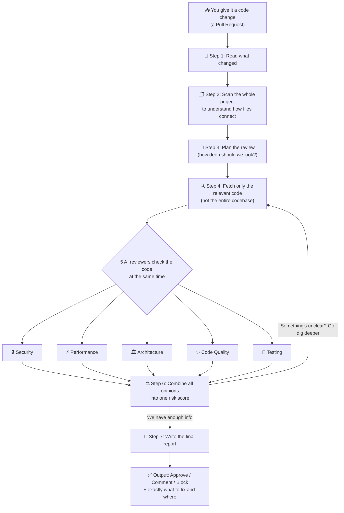

# How Argus Works (plain English)

This page explains Argus without any technical jargon — for anyone who wants
to understand what it does before diving into the code.

## The simple picture

## Step by step, in plain words

1. **You give it a code change.** Just point it at a project on your computer
   and tell it "compare version A to version B" (like comparing before/after
   a feature was added).
2. **It reads what changed.** Which files, which lines were added or removed.
3. **It scans the whole project.** Not to read every line, but to understand
   the *map* of the codebase — which files depend on which other files — so
   it knows what else might be affected by the change.
4. **It plans the review.** A tiny change to a comment doesn't need the same
   scrutiny as a change to login/payment code. It decides how deep to go.
5. **It fetches only the relevant code.** Instead of reading the entire
   codebase (slow, expensive, and unnecessary), it pulls just the changed
   code plus anything closely related to it.
6. **Five AI "reviewers" look at it at the same time** — like having five
   specialists in a room together instead of one generalist:
   - 🔒 **Security** — could this be hacked or leak data?
   - ⚡ **Performance** — will this be slow or use too much memory?
   - 🏛️ **Architecture** — is this well-structured, or does it create a mess?
   - ✨ **Code Quality** — is this readable and maintainable?
   - 🧪 **Testing** — are there missing tests for the risky parts?
7. **Their opinions get combined into one risk score.** If the combined
   answer is still unsure about something specific, it goes back and fetches
   more code to double-check — but only a couple of times, so it doesn't get
   stuck in a loop forever.
8. **It writes one final report**, telling you exactly:
   - Should this be merged? (Approve / Approve with comments / Request
     changes / Block)
   - What's wrong, in which file, on which line
   - How to fix it
   - Which parts a human should still double-check no matter what

## Why five reviewers instead of one big question?

Asking one AI "is this code any good?" gets you a vague, generic answer.
Asking five focused questions — each from a different expert's point of
view — gets you specific, useful findings, the same way a real code review
at a company often involves different people focusing on different concerns.

## Why does it only look at "relevant" code, not everything?

Real codebases can be huge — tens or hundreds of thousands of lines. Feeding
all of that to an AI for every single review would be slow, expensive, and
would actually make the answers *worse* (too much irrelevant noise). So
Argus is selective: it always looks at exactly what changed, plus anything
meaningfully connected to it, and skips the rest.

---

For the technical version of all of this — how it's actually implemented,
what tools it uses, and why — see [`Architecture.md`](Architecture.md).
